**Anything shown or said here may change. If you believe any information here is outdated or incorrect, please make an Issue!**

---

### [WateringPedestal](https://github.com/AstralButOnGitHub/Chapter-5-Lib/tree/main/scripts/objects/events/WateringPedestal.lua)
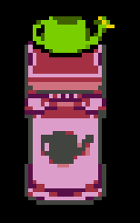

Holds a WateringCan.

| Property | Type | Default | Values | Description |
|-|-|-|-|-|
| `cutscene` | `string` | `nil` | `any` | `Plays this cutscene when interacted.` |
| `wide` | `boolean` | `false` | `true, false` | `Enables the wide variant.` |
| `can` | `string` | `"small"` | `"small", "medium", "large", "dog"` | `desc.` |
| `watering_size` | `table(int, int)` | `{1, 1}` | `any` | `The can's watering size.` |

### [WaterableFlower](https://github.com/AstralButOnGitHub/Chapter-5-Lib/tree/main/scripts/objects/events/waterable/WaterableFlower.lua)
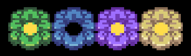

Grows when watered.

(Can be cut with WanderingScissors)

Behaviour types:
- Green: needs to be watered (Kindness)
- Blue: regrows fast (Integrity)
- Purple: regrows slow (Perserverence)
- Yellow: does nothing (Justice)

| Property | Type | Default | Values | Description |
|-|-|-|-|-|
| `color` | `string` | `"purple"` | `"green", "blue", "purple", "yellow"` | `Changes behaviour.` |
| `color_RGB` | `table(int, int, int)` | `nil(?)` | `any` | `Particle color.` |
| `bloom_state` | `int` | `1` | `1, 2, 3` | `The current growth state.` |

### [WaterableFlowerSmall](https://github.com/AstralButOnGitHub/Chapter-5-Lib/tree/main/scripts/objects/events/waterable/WaterableFlowerSmall.lua)
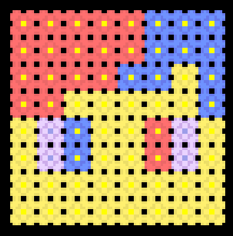

Grows when watered.

| Property | Type | Default | Values | Description |
|-|-|-|-|-|
| `color` | `string` | `"purple"` | `"black", "blue", "brown", "purple", "red", "white", "yellow"` | `Visual color.` |
| `bloom_state` | `int` | `1` | `1, 2, 3` | `The current growth state.` |

### [WaterableGrass](https://github.com/AstralButOnGitHub/Chapter-5-Lib/tree/main/scripts/objects/events/waterable/WaterableGrass.lua)
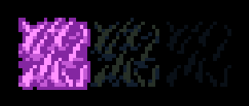

Grows when watered, is solid when not grown.

| Property | Type | Default | Values | Description |
|-|-|-|-|-|
| `color` | `string` | `"pink"` | `"pink", "dark", "darker` | `The grass color.` |

### [WaterableReeds](https://github.com/AstralButOnGitHub/Chapter-5-Lib/tree/main/scripts/objects/events/waterable/WaterableReeds.lua)
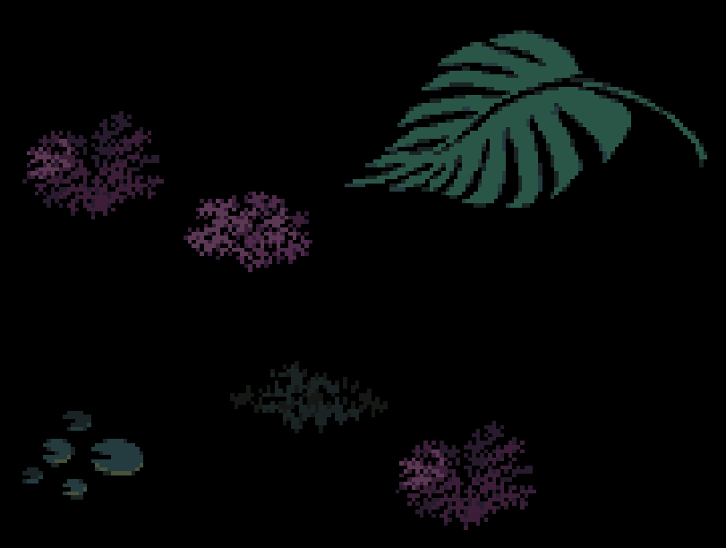

Grows when watered.

| Property | Type | Default | Values | Description |
|-|-|-|-|-|
| `reed_type` | `int` | `1` | `1..2, 3_0, 3_1, 4_0, 4_1, 5_0, 5_1, 6_0, 6_1, 7..29` | `Reed Texture (check [sprites](https://github.com/AstralButOnGitHub/Chapter-5-Lib/tree/main/assets/sprites/world/events/reeds)).` |

### [WanderingScissors](https://github.com/AstralButOnGitHub/Chapter-5-Lib/tree/main/scripts/objects/events/WanderingScissors.lua)

Cuts flowers by turning clockwise until it finds one.

| Property | Type | Default | Values | Description |
|-|-|-|-|-|
| `can_rotate` | `boolean` | `true` | `true, false` | `Allows turning.` |
| `always_move` | `boolean` | `true` | `true, false` | `Always moves in current direction.` |
| `moving_battlezone` | `boolean` | `true` | `true, false` | `Should enable a BattleZone when nearby.` |
| `direction` | `string` | `"right"` | `"up", "right", "down", "left"` | `The starting direction.` |
| `speed` | `float` | `6.5` | `any` | `The movement speed.` |
| `cut_sound` | `string` | `"board_lift"` | `any sound` | `The cutting sound.` |

### [ScissorGenerator](https://github.com/AstralButOnGitHub/Chapter-5-Lib/tree/main/scripts/objects/events/generators/ScissorGenerator.lua)

Spawns a scissor with the generator's properties as it's own properties every second.

### [ScissorRemoveZone](https://github.com/AstralButOnGitHub/Chapter-5-Lib/tree/main/scripts/objects/events/generators/ScissorRemoveZone.lua)

Removes any scissors that enter.

### [VineCuttable](https://github.com/AstralButOnGitHub/Chapter-5-Lib/tree/main/scripts/objects/events/VineCuttable.lua)
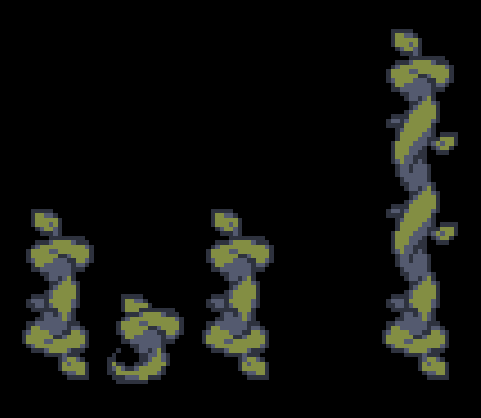

Can be climbed on when grown.

Automatically regrows after being cut.

| Property | Type | Default | Values | Description |
|-|-|-|-|-|
| `bloom_state` | `int` | `1` | `1, 2, 3` | `The current growth state.` |
| `sprite_column` | `int` | `6` | `any frame (check (frames)[https://github.com/AstralButOnGitHub/Chapter-5-Lib/tree/main/assets/sprites/world/events/vines_cuttable])` | `The starting frame (I think?? idk I ported this a month ago).` |

### [KnockoffBar](https://github.com/AstralButOnGitHub/Chapter-5-Lib/tree/main/scripts/objects/events/KnockoffBar.lua)
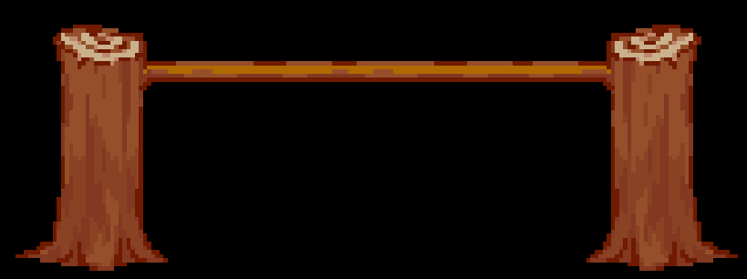

Knocks Mushrooms and Watering cans off kris' head when walked under.

| Property | Type | Default | Values | Description |
|-|-|-|-|-|
| `pedestal` | `event/marker` | `nil` | `any WateringPedestal/marker` | `When it's a pedestal; Watering cans attach to it, otherwise they move to the marker and sit there until eaten by netskie.` |

### [MushroomStool](https://github.com/AstralButOnGitHub/Chapter-5-Lib/tree/main/scripts/objects/events/MushroomStool.lua)
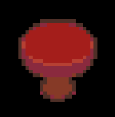

Gives mushrooms that stack on top of kris's head

### [NetskieObject](https://github.com/AstralButOnGitHub/Chapter-5-Lib/tree/main/scripts/objects/events/NetskieObject.lua)
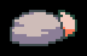

Netskies disguised as random objects. (will eat nearby mushrooms)

| Property | Type | Default | Values | Description |
|-|-|-|-|-|
| `style` | `string` | `"rock"` | `"rock", "block", "sign", "treasure_chest", "floradin_bush` | `The disguise.` |
| `solid` | `boolean` | `false` | `true, false` | `Should be solid when disguised.` |
| `text` | `tiled text` | `nil` | `any` | `Shown text.` |
| `cutscene` | `string` | `nil` | `any` | `Plays this cutscene when interacted.` |

### [PeachGenerator](https://github.com/AstralButOnGitHub/Chapter-5-Lib/tree/main/scripts/objects/events/generators/PeachGenerator.lua)

Spawns a peach every (speed) seconds.

| Property | Type | Default | Values | Description |
|-|-|-|-|-|
| `speed` | `float` | `4` | `any` | `The speed (in seconds).` |
| `spike_rate` | `int` | `4` | `any` | `Every X peaches will be spiky.` |

### [PeachRemoveZone](https://github.com/AstralButOnGitHub/Chapter-5-Lib/tree/main/scripts/objects/events/generators/PeachRemoveZone.lua)

Removes any peaches that enter.

### [ToriiGate](https://github.com/AstralButOnGitHub/Chapter-5-Lib/tree/main/scripts/objects/events/ToriiGate.lua)
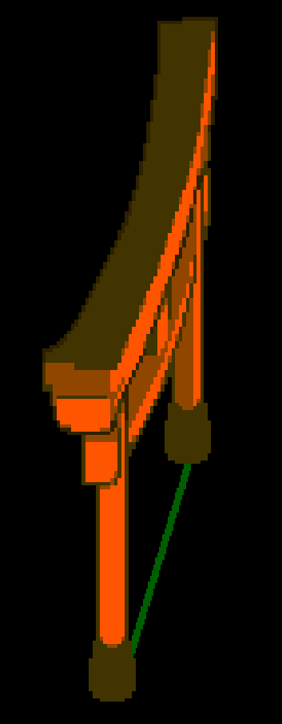

Party members start dashing upon entering.

| Property | Type | Default | Values | Description |
|-|-|-|-|-|
| `dark` | `boolean` | `true` | `true, false` | `REPLACE.` |
| `runspeed` | `int` | `20` | `any` | `REPLACE.` |

### [MudZone](https://github.com/AstralButOnGitHub/Chapter-5-Lib/tree/main/scripts/objects/events/MudZone.lua)

Spawns water particles when stepped on while dashing.

### [FusumaDoor](https://github.com/AstralButOnGitHub/Chapter-5-Lib/tree/main/scripts/objects/events/FusumaDoor.lua)
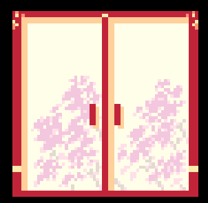

Can slide open and closed.

Can also be locked with flags

| Property | Type | Default | Values | Description |
|-|-|-|-|-|
| `can_open` | `boolean` | `true` | `true, false` | `Adds a lock if false.` |
| `fox_flag` | `string` | `nil` | `any flag` | `Adds the fox sign and needs this flag to be at 5.` |
| `variant` | `string` | `1` | `any` | `Unused texture variations.` |
| `size` | `string` | `"small"` | `"small", "big"` | `Small or big door.` |
| `text` | `tiled text` | `nil` | `any` | `Shown text.` |

### [SlidingTerakota](https://github.com/AstralButOnGitHub/Chapter-5-Lib/tree/main/scripts/objects/events/SlidingTerakota.lua)
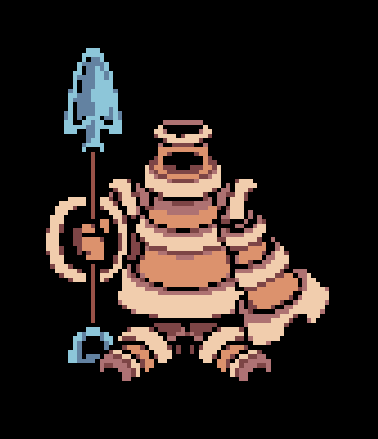

Statues of Terakota that can be moved in any direction.

Will fall when entering an ObjectFallArea

### [ObjectFallArea](https://github.com/AstralButOnGitHub/Chapter-5-Lib/tree/main/scripts/objects/events/generators/ObjectFallArea.lua)

Makes certain objects "fall" when entered.

(SlidingTerakota, NetskieObject, PhysicsMushroom, BunnyPlant)

### [AquaKnife](https://github.com/AstralButOnGitHub/Chapter-5-Lib/tree/main/scripts/objects/events/AquaKnife.lua)
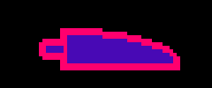

Spinning Knife that hurts when touched. 

| Property | Type | Default | Values | Description |
|-|-|-|-|-|
| `amplitude` | `float` | `80` | `any` | `Movement sin amplitude.` |
| `offset` | `float` | `0` | `any` | `Movement offset.` |

### [BunnyPlant](https://github.com/AstralButOnGitHub/Chapter-5-Lib/tree/main/scripts/objects/events/BunnyPlant.lua)
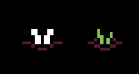

bnnuy

| Property | Type | Default | Values | Description |
|-|-|-|-|-|
| `bunny` | `boolean` | `false` | `true, false` | `Is a bunny.` |

### [PuzzleBell](https://github.com/AstralButOnGitHub/Chapter-5-Lib/tree/main/scripts/objects/events/PuzzleBell.lua)
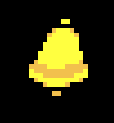

does stuff

| Property | Type | Default | Values | Description |
|-|-|-|-|-|
| `REPLACE` | `REPLACE` | `REPLACE` | `REPLACE` | `REPLACE.` |

### [LeafPile](https://github.com/AstralButOnGitHub/Chapter-5-Lib/tree/main/scripts/objects/events/LeafPile.lua)
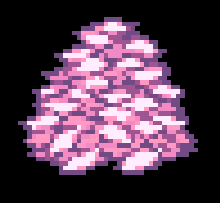

Can be scattered when dashing. 

### [FusumaWall](https://github.com/AstralButOnGitHub/Chapter-5-Lib/tree/main/scripts/objects/events/FusumaWall.lua)
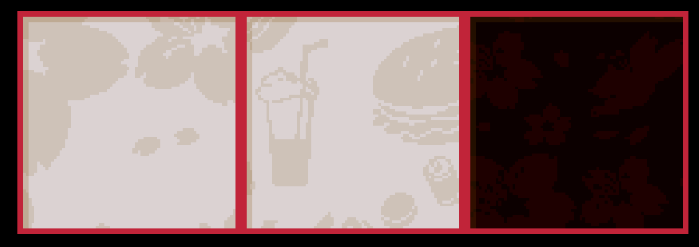

Shows the shadow of Characters and certain Events when behind.

| Property | Type | Default | Values | Description |
|-|-|-|-|-|
| `yoffset` | `float` | `0` | `any` | `the distance the wall is above the floor.` |
| `style` | `string` | `"floral"` | `"floral", "burger", "red"` | `The repeating texture.` |
| `borders` | `boolean` | `true` | `true, false` | `Shows the red border around the edges.` |
| `hidden` | `boolean` | `false` | `true, false` | `Only renders the shadows.` |
| `color` | `Color` | `"83503a"` | `any` | `The shadow color.` |

### [TallGrass](https://github.com/AstralButOnGitHub/Chapter-5-Lib/tree/main/scripts/objects/events/TallGrass.lua)
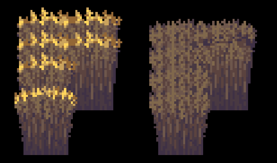

Can be pushed by Characters and "Harvested" when dashing.

| Property | Type | Default | Values | Description |
|-|-|-|-|-|
| `lit` | `boolean` | `false` | `true, false` | `Shows the lit textures.` |